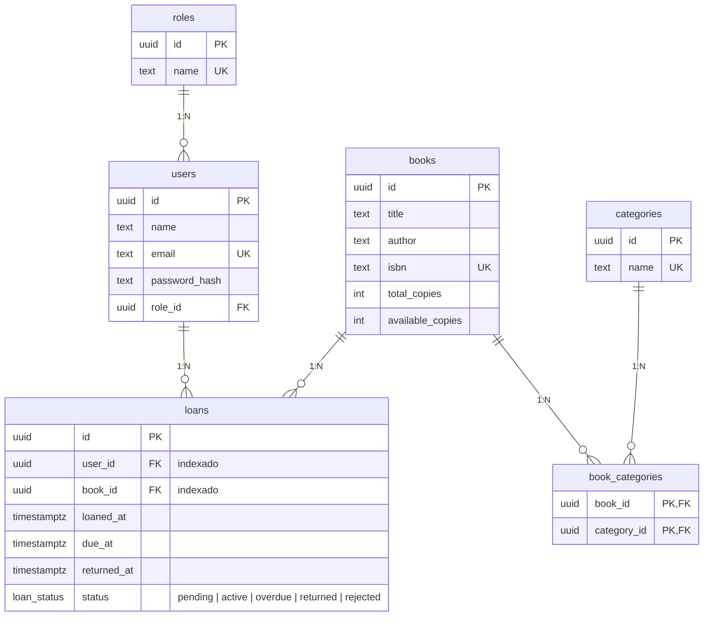

# Modelo entidad-relación

La imagen original está en [`DER.jpg`](DER.jpg). Esta versión en Mermaid es la misma
y se puede versionar y comparar en los diffs. El esquema real está en
`migrations/versions/0001_initial_schema.py`.

## Relaciones que pide la prueba

| Requisito | Dónde |
|---|---|
| Tabla pivote | `book_categories`: libros y categorías de muchos a muchos. La PK es la pareja `(book_id, category_id)`, así que un libro no se asigna dos veces a la misma categoría |
| Muchos a uno | `loans → books` y `loans → users`: cada préstamo es de un libro y de un usuario |
| Uno a muchos | `users → loans`: un usuario tiene muchos préstamos (también `roles → users`) |

## Decisiones

- **Roles en su propia tabla.** El token lleva el rol leído de `roles` al iniciar sesión, y se pueden agregar roles sin tocar la estructura.
- **Identificadores UUID** en todas las tablas, para no exponer números consecutivos adivinables en las rutas. Se generan en el dominio, así que el repositorio en memoria y el de Postgres se comportan igual.
- **`available_copies`** está protegido por `CHECK (available_copies >= 0 AND available_copies <= total_copies)`.
- **`returned_at` vacío** significa que el libro no se ha devuelto. `status` distingue además entre pendiente, activo, vencido, devuelto y rechazado.
- **Índices explícitos** en `loans.user_id` y `loans.book_id`, porque Postgres no indexa las llaves foráneas por su cuenta.
- **`ON DELETE RESTRICT`** en las llaves de `loans` y `users`: no se borra un libro ni un usuario con préstamos. En la pivote es `CASCADE`.
